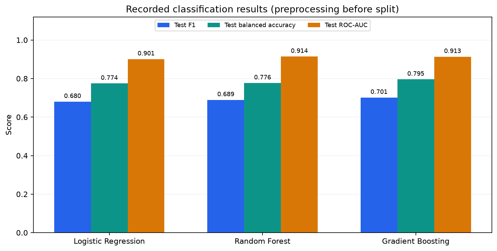
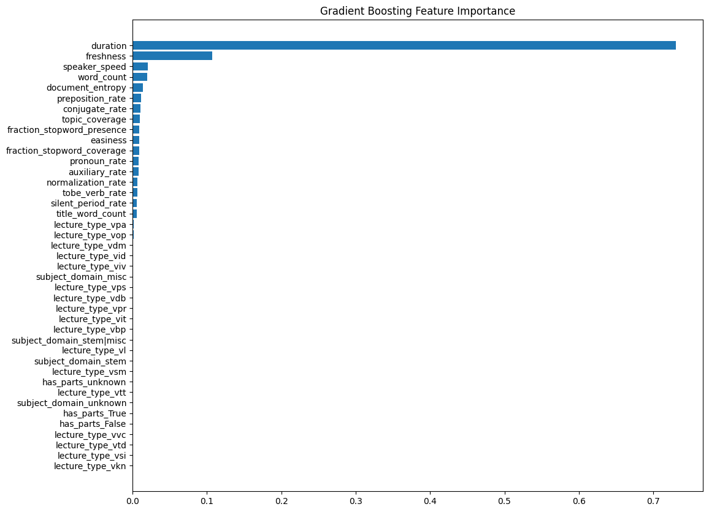

# Video Lecture Engagement Prediction

Predict video engagement from linguistic and presentation features, and compare linear models with tree ensembles on an imbalanced classification task.

The implementation covers exploratory analysis, preprocessing, ridge regression, binary classification, model comparison, and error analysis. All executable project code is in [engagement_prediction.py](engagement_prediction.py).

## Objective and data

The recorded dataset contains **11,548 video lectures**, **21 candidate features**, and the target `median_engagement`. The classification task identifies examples with engagement **at least 0.2**; approximately **15.62%** of examples are positive.

Features describe language usage, readability, transcript length, duration, speaking rate, topic coverage, and categorical lecture metadata. Missingness is concentrated in `subject_domain` (48.80%) and `has_parts` (18.64%).

The dataset is not included. Its public download source and redistribution license could not be established from the available files. Input requirements are documented in [data/README.md](data/README.md). 

## Approach

```text
Lecture features and engagement target
    -> Missing-value handling and IQR clipping
    -> Log transforms, one-hot encoding, and standardization
    -> Ridge regression on the continuous target
    -> Binary target: engagement >= 0.2
    -> Stratified 80/20 train/test split
    -> Logistic Regression / Random Forest / Gradient Boosting
    -> F1, balanced accuracy, ROC-AUC, confusion matrices, feature importance
```

The preprocessing drops the high-cardinality topic URL, fills categorical gaps with `unknown`, imputes numerical gaps with medians, clips numerical values to IQR boundaries, and applies `log1p` to selected skewed features. Numerical predictors are standardized; one-hot columns remain 0/1.

This ordering preserves the recorded experiment: preprocessing is fitted **before** splitting and IQR clipping includes the continuous target. These are known limitations, not recommended evaluation practices.

| Model | Active settings |
| --- | --- |
| Ridge Regression | alpha=1.0, intercept enabled; scored in-sample |
| Logistic Regression | L2, C=1.0, lbfgs, max_iter=1000 |
| Random Forest | 300 trees, max_depth=10, min_samples_split=5, min_samples_leaf=2 |
| Gradient Boosting | 300 estimators, learning_rate=0.05, max_depth=3, subsample=0.9 |

The split and tree-model random states are 42. Classification uses the models' default decision rule. F1 and balanced accuracy retain the existing explicit confusion-count implementations.

## Recorded results

These are historical execution outputs from the final implementation. They are not presented as leakage-free estimates of performance on unseen data.

| Model | Train F1 | Test F1 | Test balanced accuracy | Test ROC-AUC |
| --- | ---: | ---: | ---: | ---: |
| Logistic Regression | 0.6471 | 0.6799 | 0.7744 | 0.9008 |
| Random Forest | 0.7394 | 0.6891 | 0.7765 | **0.9142** |
| Gradient Boosting | 0.7487 | **0.7013** | **0.7955** | 0.9134 |

Gradient Boosting has the highest recorded F1 and balanced accuracy; Random Forest has the highest recorded ROC-AUC. Differences are from one split, without uncertainty estimates.





Feature importance describes the fitted model rather than causal effects on engagement. The ridge model's recorded in-sample R2 is **0.5628**, measured against the clipped target; no held-out ridge result is claimed. See [results/README.md](results/README.md) for measurement provenance.

## Installation

Use a clean Python environment:

```bash
python3 -m venv .venv
source .venv/bin/activate
python -m pip install -r requirements.txt
```

The implementation uses Python, NumPy, pandas, scikit-learn, and Matplotlib. Training runs on a CPU; no GPU or account sign-in is needed. The dependency file pins the versions used to validate this standalone implementation. The original environment versions remain unknown.

## Usage

Place a permitted compatible input at `data/lectures_dataset.csv`, then run from this directory:

```bash
python engagement_prediction.py --data data/lectures_dataset.csv --output-dir runs/latest
```

The script saves numeric summaries and distribution plots, trains the retained model configurations, and writes regression metrics, classification metrics, confusion matrices, ROC plots, and feature importances. Processed arrays are saved only in the ignored output directory.

Skip the exploratory plots while running the models:

```bash
python engagement_prediction.py --data data/lectures_dataset.csv --skip-eda
```

Regenerate the README comparison chart without the dataset or model training:

```bash
python engagement_prediction.py --plot-recorded
```

New runs are separate from the historical records under `results/`. Model configurations are retained, but dependency-version differences can change results.

## Validation

The standalone script was run end to end on the supplied 11,548-row input, including exploratory analysis, all four estimators, metric export, and plotting. The eight retained core functions were also checked structurally against the final implementation, and the manual classification metrics were checked against scikit-learn.

Ridge R2 and Logistic Regression scores agree with the saved results at the displayed precision. The validation run produced Random Forest test F1 **0.6869** and Gradient Boosting test F1 **0.6962**, differing from the historical table. The exact cause is not established because the original runtime state and dependency versions are unavailable. Historical scores are preserved separately from [validation metrics](results/validation_metrics.csv); the tested environment and dataset summary are recorded in [validation_summary.json](results/validation_summary.json).

## Evaluation limitations

- Imputation, clipping boundaries, encoding, and scaling are derived from the full dataset before the split. Test information therefore influences preprocessing.
- IQR clipping changes **1,306 continuous target values** in the recorded input. The ridge result evaluates this modified target. On these data, the 0.2 classification labels remain unchanged by clipping.
- Model configurations were compared on the same test partition. It was not an untouched final holdout, and there is no nested cross-validation or independent external evaluation.
- Small train/test metric gaps alone do not establish generalization. No deployment, causal inference, or production-readiness claim is made.
- Correcting preprocessing and model selection would create a new experiment with new measurements; the historical metrics must not be reused for that revised protocol.

## Files

```text
lecture-engagement-prediction/
├── README.md
├── engagement_prediction.py
├── requirements.txt
├── .gitignore
├── data/
│   └── README.md
├── figures/
│   ├── model_comparison.png
│   └── gradient_boosting_feature_importance.png
└── results/
    ├── README.md
    ├── recorded_metrics.csv
    ├── recorded_regression.json
    ├── validation_metrics.csv
    └── validation_summary.json
```
